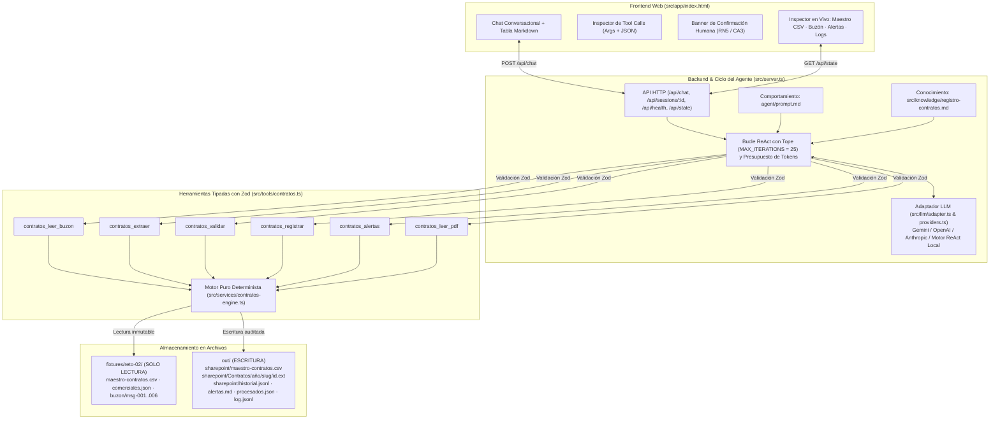

# SOLUCION.md — Reto Técnico 02: Agente Conversacional "Registro de Contratos Vigentes"

> **Equipo Perxia 2.0 · Periferia IT Group**
> **Versión:** 2.0 · **Fecha:** Septiembre 2026

---

## 1. Problema en una frase y a quién le duele

**Problema en una frase:** Periferia IT Group carece de visibilidad y control sobre sus obligaciones contractuales vigentes porque su registro maestro en SharePoint quedó congelado el **30 de mayo de 2026** tras la salida de un aprendiz y solo recibe contratos cuando el área comercial necesita gestionar una póliza.

**A quién le duele:**
- **A la Analista Administrativa (usuaria principal):** debe reconstruir manualmente información dispersa en correos personales, leer documentos extensos y perseguir pólizas sin un canal único de recepción.
- **A la Gerencia y Dirección Financiera/Operativa:** no pueden responder qué contratos vencen en el trimestre, qué ingresos están respaldados contractualmente ni qué pólizas exigidas por los clientes están pendientes o próximas a expirar (riesgo de incumplimiento contractual y sanciones).
- **Al Área Comercial:** carece de un proceso estandarizado con acuse de recibo y alertas tempranas para renovar cuentas clave antes de su vencimiento.

---

## 2. Arquitectura de la Solución

La arquitectura separa estrictamente **Comportamiento** (`agent/prompt.md`), **Conocimiento de Negocio** (`src/knowledge/registro-contratos.md`), **Orquestación / Ciclo del Agente** (`src/server.ts` + `src/llm/`) y **Ejecución Determinista** (`src/tools/contratos.ts` + `src/services/contratos-engine.ts`), además del empaquetado modular reutilizable en `modulo/`.

### Ubicación de responsabilidades
| Capa | Ruta | Responsabilidad |
|---|---|---|
| **Comportamiento** | `agent/prompt.md` y `modulo/agent.md` | Reglas de actuación del agente (CA1–CA5), prohibición de alucinación y protocolo de pregunta explícita para confirmación humana. |
| **Conocimiento** | `src/knowledge/registro-contratos.md` y `modulo/skill/registro-contratos/SKILL.md` | Reglas de negocio RN1–RN7, normalización de NIT/RUC/monedas y criterios de alertas de vencimiento. |
| **Ejecución (Tools)** | `src/tools/contratos.ts` y `modulo/tools/contratos.ts` | Contratos de herramientas tipados con `zod` (`description`, `args`, `execute(args, ctx)`). Nunca lanzan excepciones; devuelven `{ ok: true, data }` o `{ ok: false, error }`. |
| **Motor Determinista** | `src/services/contratos-engine.ts` | Lógica pura en TypeScript (sin LLM) para parseo de fechas en español, montos, pólizas, similitud léxica, escritura CSV/JSONL y generación de `out/alertas.md`. |
| **Adaptador LLM** | `src/llm/adapter.ts` y `src/llm/providers.ts` | Interfaz desacoplada `LLMAdapter` (`enviar(mensajes, herramientas)`) con implementaciones para Google Gemini, OpenAI, Anthropic y un motor ReAct determinista local de respaldo. |

---

## 3. Ciclo del Agente, Tope de Iteraciones y Confirmación Humana (HITL)

El ciclo del agente está implementado en `ejecutarTurnoAgente` (`src/server.ts`):

1. **Inicialización de sesión y contexto**:
   - Al recibir `POST /api/chat` con `{ sessionId, message }`, se recupera o crea la sesión en memoria inyectando como mensaje `system` la concatenación de `agent/prompt.md` y `src/knowledge/registro-contratos.md`.
   - Se verifica que el consumo acumulado de la sesión no supere `MAX_TOKENS_PER_SESSION` (`120,000` tokens por defecto).

2. **Bucle ReAct con tope estricto (`MAX_ITERATIONS_PER_TURN = 25`, Regla CA1)**:
   - En cada iteración se invoca `adaptador.enviar(sesion.messages, esquemasHerramientas)`.
   - Si la respuesta contiene `toolCalls`:
     - Para cada llamada, el servidor valida los argumentos contra el esquema `zod` de la herramienta antes de ejecutarla.
     - Se invoca `toolDef.execute(args, { directory, sessionId })`, lo cual deja rastro inmediato en `out/log.jsonl` (Regla CA4 / RN7) y se almacena en el historial de la sesión (`toolCallsTurno`).
     - El resultado JSON serializado se agrega a `sesion.messages` con `role: "tool"` y el bucle continúa.
   - Si el modelo devuelve texto final sin `toolCalls`, el bucle termina y devuelve la respuesta al usuario.
   - Si se alcanza la iteración `25` sin cerrar turno, el ciclo se detiene de forma segura e informa al usuario qué herramientas se ejecutaron y qué quedó pendiente.

3. **Mecanismo de Confirmación Humana — Human-in-the-Loop (Reglas CA3 y RN5)**:
   - Cuando `contratos_validar` detecta cualquier campo con `confianza < 0.80` (por ejemplo, en `msg-006` donde `valor = 0` por ser contrato marco por demanda tiene confianza `0.65` y `fecha_fin = "2027-08-31"` derivada de un plazo de 12 meses sobre una firma sin día exacto tiene confianza `0.60`), devuelve `requiere_revision: ["valor", "fecha_fin"]`.
   - Si se intenta llamar a `contratos_registrar` con `confirmado: false`, la herramienta **bloquea la escritura** y retorna `{ ok: false, error: "requiere revisión: [valor, fecha_fin]..." }`.
   - El servidor activa el indicador `needsConfirmation: true` en la respuesta de la API y el agente finaliza el turno mostrando el detalle campo por campo y formulando una pregunta explícita de confirmación.
   - El frontend resalta el turno y despliega un banner interactivo de confirmación. Solo cuando la analista confirma en el siguiente mensaje (ej. *"Confirmo el valor 0 y la fecha fin 2027-08-31"*), el agente invoca `contratos_registrar` con `confirmado: true`, completando la escritura en el maestro y en `historial.jsonl`.

---

## 4. Elección del Modelo y Análisis de Costos

### Proveedor y Modelo Elegido
- **Modelo principal recomendado:** **Google Gemini 2.5 Flash (`gemini-2.5-flash`)** (con soporte intercambiable por variable de entorno para OpenAI `gpt-4o-mini` y Anthropic `claude-3-5-haiku-latest`, además de un motor ReAct determinista local cuando se ejecuta sin clave de API).
- **Por qué `gemini-2.5-flash`:**
  1. **Baja latencia en bucles multi-herramienta:** procesar un lote de 6 mensajes requiere ~15 llamadas secuenciales/paralelas a herramientas; un modelo Flash mantiene el tiempo de respuesta total por debajo de 6–10 segundos.
  2. **Precisión en Function Calling estructurado:** dado que la extracción pesada ocurre de forma determinista en `contratos-engine.ts`, el modelo solo necesita orquestar las herramientas, respetar las restricciones negativas (`confirmado: false`) y sintetizar tablas Markdown fieles a los datos devueltos.
  3. **Costo marginal mínimo:** ideal para un buzón corporativo de operación continua.

### Estimación de Costos por Caso Procesado y por Mes
Con base en las tarifas públicas de **Gemini 2.5 Flash** (\$0.15 USD / 1M tokens de entrada y \$0.60 USD / 1M tokens de salida) y **GPT-4o-mini** (\$0.15 USD / 1M entrada y \$0.60 USD / 1M salida):

| Concepto | Tokens de Entrada | Tokens de Salida | Costo unitario (USD) |
|---|---:|---:|---:|
| **Por mensaje individual (1 correo + extracción + validación + registro)** | ~2,800 tokens | ~450 tokens | **\$0.00069 USD** (~0.07 centavos de dólar) |
| **Lote completo del reto (6 mensajes + confirmación HITL + reporte de alertas)** | ~16,500 tokens | ~2,600 tokens | **\$0.00404 USD** (~0.4 centavos de dólar) |
| **Operación mensual estimada Periferia (150 correos/mes + 30 reportes)** | ~450,000 tokens | ~75,000 tokens | **\$0.1125 USD / mes** |

---

## 5. Estrategia de Extracción y Cálculo de Confianza

Toda la extracción base reside en `src/services/contratos-engine.ts` (`ejecutarExtraerContrato`) y es **100% determinista**, garantizando que ningún valor registrado en el CSV dependa de la creatividad del LLM (Regla CA2):

1. **Detección de Tipo Documental y Rechazo Temprano (HU-1 / RN4)**:
   - Se inspecciona el nombre del adjunto (`contrato.txt`, `otrosi.txt`, `cotizacion.txt`), el encabezado del documento y el cuerpo del correo.
   - Si el documento es una cotización (`COTIZACIÓN No. COT-2026-088` en `msg-005`) o el correo advierte *"Aún no hay contrato"*, se marca `tiene_contrato = false` y se clasifica como `rechazado` con confianza `0`.

2. **Partes, NIT/RUC y País (`cliente`, `nit_cliente`, `pais`)**:
   - Se extrae la cláusula de comparecencia (`Entre [ los suscritos, ] <RAZÓN SOCIAL>, identificada con NIT/RUC <NÚMERO>...`).
   - Se normaliza la razón social a *Title Case* preservando siglas societarias (`S.A.S.`, `S.A.`, `S.A.C.`, `S. de R.L.`).
   - Al identificador tributario se le eliminan puntos y el dígito de verificación tras guion (`890.900.111-4` $\rightarrow$ `890900111`), asignando confianza `1.0`.
   - El país (`CO | EC | PE | PA | HN`) se resuelve por ciudad/país de domicilio (`Bogotá/Medellín/Barranquilla` $\rightarrow$ `CO`, `Quito/Ecuador` $\rightarrow$ `EC`, `Lima/Perú` $\rightarrow$ `PE`) y estructura de RUC/NIT (confianza `1.0`).

3. **Valor y Moneda (`valor`, `moneda`, `valor_indeterminado`)**:
   - Se analiza la cláusula de `VALOR`. Si contiene divisa y cifra explícita (`COP $265.000.000`, `USD 120,000.00`, `PEN 520,000.00`), se eliminan decimales `.00` y separadores de miles y se asigna confianza `1.0`.
   - Si el texto indica cuantía indeterminada o por demanda (*"no tiene un valor determinado"*, *"según las tarifas del Anexo 1"* en `msg-006`), se asigna `valor = 0` y `valor_indeterminado = true`, pero con **`confianza.valor = 0.65` ($< 0.80$)** para obligar a que la analista confirme antes de escribir en el maestro.

4. **Plazo y Vigencia (`fecha_inicio`, `fecha_fin`)**:
   - El parser `parsearFechaEspanol` traduce fechas textuales legales (`"primero (1) de agosto de 2026"`, `"treinta y uno (31) de julio de 2027"`) a `YYYY-MM-DD` con confianza `1.0`.
   - En un **Otrosí** (`msg-003`), detecta *"se extiende hasta el primero (1) de noviembre de 2027"* (`2027-11-01`, confianza `1.0`) y conserva `fecha_inicio` del contrato base (`2026-05-02`).
   - Cuando el contrato expresa únicamente duración en meses (*"duración de doce (12) meses contados a partir de la fecha de su firma"*) y la línea de firma no tiene día exacto (*"Se firma en Barranquilla, en el mes de agosto de 2026"* en `msg-006`), calcula `fecha_inicio = "2026-08-01"` y `fecha_fin = "2027-08-31"` con **`confianza.fecha_fin = 0.60` ($< 0.80$)**, disparando `requiere_revision`.

5. **Pólizas (`requiere_poliza`, `tipo_poliza`, `estado_poliza`)**:
   - Se busca la cláusula `GARANTÍAS`. Si existe, se extraen los amparos (`cumplimiento`, `calidad`, `salarios_prestaciones`, `responsabilidad_civil`) unidos por `;`, asignando `requiere_poliza = true` y `estado_poliza = "pendiente"` (o conservando el estado del contrato base si es un otrosí). Si no existe cláusula de garantías (`msg-002`), se asigna `requiere_poliza = false`, `tipo_poliza = ""` y `estado_poliza = "no_aplica"`.

---

## 6. Propuesta de Regla de Gobierno Corporativo de Contratos (Sección 7.5)

### Política Corporativa `GOV-2026-01`: Punto Único de Recepción y Control de Contratos Comerciales

1. **Canal Único Oficial y Administración**:
   - **Buzón único obligatorio:** `contratos@periferiaitgroup.com` (operado por el Agente Perxia 2.0 en conexión directa con SharePoint Corporativo).
   - **Dueña del proceso (Data Owner):** **Analista Administrativa de Operaciones Comerciales**, con supervisión mensual de la **Gerencia Administrativa y Financiera** (supliendo la ausencia de área legal interna). Ningún contrato enviado a correos personales se considera radicado.

2. **Obligación del Comercial (Qué, Cuándo y Cómo)**:
   - **Qué debe enviar:** Todo contrato principal firmado por ambas partes (con o sin póliza), acuerdos marco, órdenes de servicio, otrosíes modificatorios y actas de liquidación/terminación en formato PDF con texto seleccionable.
   - **Plazo máximo (SLA de envío):** Dentro de los **dos (2) días hábiles siguientes a la firma** del documento por parte del cliente.
   - **Formato obligatorio de asunto:**
     `[PAIS] - [TIPO: CONTRATO | MARCO | OTROSI | ACTA] - [NIT/RUC CLIENTE] - [NOMBRE CLIENTE] - [ID CONTRATO]`
     *(Ejemplo: `[CO] - [CONTRATO] - [890900111] - [Industrias Delta] - [CT-2026-015]`)*.

3. **Acuse Automático del Agente**:
   - En un tiempo máximo de **2 minutos** tras la recepción del correo, el Agente Perxia 2.0 responde automáticamente al comercial remitente (con copia a la Analista Administrativa) con uno de tres estados:
     - **Radicado Exitoso (`RAD-OK`):** incluye el `id_contrato`, enlace a la carpeta de SharePoint y alerta al corredor de seguros si `requiere_poliza = true`.
     - **Retenido por Revisión Humana (`RAD-REV`):** informa qué campos presentaron confianza $< 0.80$ y notifica que la Analista Administrativa confirmará el registro en $< 4$ horas hábiles.
     - **Rechazado (`RAD-REJ`):** si el adjunto es una cotización sin firma o está incompleto, indicando la acción correctiva.

4. **Manejo de Excepciones y Matriz de Escalamiento**:
   - **Contrato sin firmas o borrador/cotización:** el agente lo rechaza automáticamente (`RN4`) y solicita al comercial enviar únicamente el ejemplar perfeccionado.
   - **Contrato marco por demanda (sin valor fijo) o sin día exacto de vigencia:** el agente propone `valor = 0` (`valor_indeterminado = true`) y calcula la vigencia tentativa con confianza $< 0.80$, escalándolo a la **Analista Administrativa** en el panel HITL. Si el contrato supera USD \$100,000 o exige garantías atípicas, la Analista escala la aprobación a la **Dirección Administrativa y Financiera** en un plazo máximo de 24 horas.
   - **Remitente no registrado en `comerciales.json` (ej. practicantes o nuevos ingresos):** el agente procesa el contrato pero emite alerta a Gestión Humana / Dirección Comercial para oficializar el alta del colaborador en el catálogo.

5. **Campaña de Cierre del Gap Histórico (Junio – Agosto 2026)**:
   - Se ejecutará una **Campaña Única de Conciliación de 5 días ("Operación Cero Brecha")** cruzando tres fuentes:
     1. **Facturación emitida (ERP / Contabilidad)** entre el `2026-06-01` y el `2026-08-31` de clientes cuyo contrato no figure activo en el maestro.
     2. **Búsqueda automatizada en Exchange ( vía regla de transporte/eDiscovery)** de todos los correos enviados o recibidos por los correos de `comerciales.json` con adjuntos `.pdf`/`.docx` que contengan las palabras `"CONTRATO"`, `"OTROSÍ"` o `"PÓLIZA"` entre el `2026-05-30` y el `2026-09-03`, reenviándolos en lote a `contratos@periferiaitgroup.com`.
     3. **Declaración jurada de cartera por Director Regional**, bloqueando el pago de comisiones comerciales de septiembre para negocios cerrados en Q2/Q3 cuyos contratos no estén radicados en el buzón al cierre de la campaña.

6. **Indicador Mensual de Supervivencia del Proceso (KPI de Gobierno)**:
   - **Índice de Cobertura Contractual de Facturación ($\text{ICCF}$):**
     $$\text{ICCF} = \left( \frac{\text{Facturas emitidas en el mes con } \texttt{id\_contrato} \text{ vigente en el Maestro}}{\text{Total de facturas de servicios emitidas en el mes}} \right) \times 100\%$$
   - **Meta obligatoria:** $\text{ICCF} = 100\%$. Regla de bloqueo financiero: a partir del mes 2, el área de Facturación no podrá emitir factura a ningún cliente sin validar que su `id_contrato` exista y tenga estado vigente (y póliza constituida cuando aplique) en `maestro-contratos.csv`.

---

## 7. Decisiones de Diseño y Trade-offs

1. **Extracción Determinista con Heurísticas Tipadas vs. Extracción Directa por LLM**:
   - *Decisión:* Implementar toda la extracción de campos y el cálculo de confianza en TypeScript puro (`src/services/contratos-engine.ts`) y exponerla mediante `contratos_extraer`.
   - *Alternativa descartada:* Pedirle al LLM que extraiga el JSON libremente leyendo el texto crudo del contrato.
   - *Por qué:* La regla **CA2** y el riesgo de la sección 10 del PRD advierten que el LLM puede "redondear" valores o inventar fechas. Con extracción determinista garantizamos idempotencia total en `demo.ts` sin consumir tokens y evitamos alucinaciones numéricas.

2. **Servidor Full-Stack Unificado en TypeScript (`src/server.ts`) con Handler Web Standard (`Request` $\rightarrow$ `Response`) vs. Repositorios Separados Front/Back**:
   - *Decisión:* Unificar el backend de la API y el servidor del frontend interactivo en un único proceso ligero (`bun run dev`), usando el estándar Fetch `Request`/`Response` de Bun/Web.
   - *Alternativa descartada:* Crear dos proyectos separados (ej. Vite + Express en puertos distintos con CORS y doble `package.json`).
   - *Por qué:* Cumple estrictamente el requisito no funcional de levantar toda la solución con un solo comando en menos de 2 segundos, facilita el despliegue inmediato en un solo contenedor o servicio web y permite ejecutar pruebas de integración HTTP en memoria en milisegundos.

3. **Adaptador Multi-Proveedor con Respaldo ReAct Determinista Local (`src/llm/providers.ts`) vs. Dependencia Exclusiva de un SDK Propietario**:
   - *Decisión:* Implementar `LLMAdapter` mediante `fetch` nativo compatible con Gemini, OpenAI y Anthropic, acompañado de `DeterministicReActAdapter` cuando no hay API Key configurada o hay caída de red.
   - *Alternativa descartada:* Acoplar el servidor al SDK oficial de un único proveedor y fallar con `500 Internal Server Error` si no hay clave en `.env`.
   - *Por qué:* Garantiza que el evaluador pueda probar la interfaz web de chat tanto con su propia clave (`GEMINI_API_KEY`, `OPENAI_API_KEY`, `ANTHROPIC_API_KEY`) como en modo local inmediato, cumpliendo CA5 (la sesión nunca muere).

---

## 8. Supuestos Tomados al Interpretar el PRD

1. **Conservación de `fecha_registro` original en actualizaciones por Otrosí (`msg-003`):** Cuando un otrosí actualiza un contrato que ya existía antes del corte del `2026-05-30` (`CT-2026-011`, registrado el `2026-05-05`), se conserva su `fecha_registro` original en el CSV y se registra el cambio con timestamp exacto en `out/sharepoint/historial.jsonl`, de modo que la lista `registrados_desde_corte` contenga exclusivamente contratos nuevos posteriores al `2026-05-30` (`CT-2026-015`, `CT-2026-016`, `CM-2026-03`) mientras el reporte `out/alertas.md` documenta tanto los nuevos como los otrosíes aplicados.
2. **Derivación de `fecha_fin` en contratos con firma mensual sin día (`msg-006`):** En `msg-006`, el contrato indica *"duración de doce (12) meses contados a partir de la fecha de su firma"* y *"Se firma en Barranquilla, en el mes de agosto de 2026"*. Se asume el mes completo de agosto de 2026 como inicio (`2026-08-01`) y el cierre de los 12 meses al último día de agosto del año siguiente (`2027-08-31`), asignando confianza `0.60` ($< 0.80$) para que coincida exactamente con la confirmación esperada en la sección 11 del PRD (`2027-08-31`).
3. **Convención de `<cliente-slug>` en rutas de SharePoint:** A partir del análisis de `fixtures/reto-02/maestro-contratos.csv`, se observó que las carpetas de SharePoint omiten el tipo societario (`Industrias Delta S.A.S.` $\rightarrow$ `industrias-delta`, `Minera Los Andes S.A.C.` $\rightarrow$ `minera-los-andes`). El generador de slugs replica exactamente esa regla.

---

## 9. Cobertura de Historias de Usuario y Qué Falta para Producción

| Historia / Requisito | Estado | Detalle de Implementación | Qué falta para Producción Real |
|---|---|---|---|
| **HU-1 · Leer el buzón** (`contratos_leer_buzon`) | **Hecho (100%)** | Lista mensajes no procesados con `tiene_contrato` y detecta cotizaciones (`msg-005`). | Conector Microsoft Graph API (webhook de buzón Exchange Online). |
| **HU-2 · Extraer datos** (`contratos_extraer`) | **Hecho (100%)** | Extracción determinista de las 16 columnas con puntajes de confianza `[0, 1]`. | Pipeline OCR (Azure AI Document Intelligence / Google Document AI) para PDFs escaneados en imagen. |
| **HU-3 · Validar y clasificar** (`contratos_validar`) | **Hecho (100%)** | Clasifica en `nuevo`, `actualizacion`, `duplicado`, `rechazado` (RN1–RN5) y cruza `comerciales.json`. | Integración en vivo con directorio activo (Entra ID / Azure AD) para catálogo de comerciales. |
| **HU-4 · Registrar y archivar** (`contratos_registrar`) | **Hecho (100%)** | Bloquea si `requiere_revision` no está vacío y `confirmado != true`; escribe en CSV, archiva adjunto y audita en `historial.jsonl`. | Escritura transaccional en SharePoint Online Lists / Graph API con bloqueo de concurrencia (ETag). |
| **HU-5 · Alertar** (`contratos_alertas`) | **Hecho (100%)** | Genera `out/alertas.md` determinista según parámetro `hoy` con las 3 secciones requeridas. | Envío programado por correo/Teams a Gerencia y corredor de seguros. |
| **HU-6 · Manejo de errores** | **Hecho (100%)** | Respuestas tipadas `{ ok: false, error }`, sin abortar lotes ni sesiones. | Monitoreo centralizado y alertas operativas (OpenTelemetry / Sentry). |
| **P1 · Leer PDF** (`contratos_leer_pdf`) | **Hecho (100%)** | Extracción de texto de flujos PDF nativos y archivos `.txt` con protección contra *path traversal*. | Soporte para PDFs cifrados o con múltiples columnas complejas. |
| **Bonus · Módulo reutilizable (`modulo/`)** | **Hecho (100%)** | `modulo/agent.md`, `modulo/tools/contratos.ts` y `modulo/skill/registro-contratos/SKILL.md` sincronizados con la app. | Publicación en registro privado NPM de Periferia IT Group. |

---

## 10. Declaración de Uso de IA Durante la Construcción

- **Asistente utilizado:** **Google Antigravity (Gemini)** como asistente de programación agéntica en pareja.
- **Tareas en las que se utilizó:**
  1. Análisis cruzado de `PRD.md` frente a los 6 casos de prueba de `fixtures/reto-02/buzon/` y el archivo `maestro-contratos.csv`.
  2. Estructuración de expresiones regulares en español para fechas contractuales (`parsearFechaEspanol`) y montos multimoneda (`COP`, `USD`, `PEN`).
  3. Construcción de la interfaz web dividida (Chat + Inspector de Tool Calls + Tablero SharePoint en vivo) y suite de pruebas automatizadas (`tests/contratos.test.ts`).
- **Propuestas descartadas del asistente y por qué:**
  - *Descartado 1:* Usar un parser CSV ingenuo basado en `line.split(",")`. Se descartó porque un objeto contractual con comas (como el de `msg-001`: *"implementación, parametrización y soporte..."*) corrompería las columnas del CSV. Se implementó en su lugar un parser y serializador RFC-4180 con escape de comillas (`parsearLineaCSV` y `escaparCampoCSV`).
  - *Descartado 2:* Actualizar la columna `fecha_registro` cuando se procesa un otrosí (`msg-003`). Se descartó porque haría que un contrato antiguo (`CT-2026-011`, registrado en mayo) apareciera erróneamente como "nuevo contrato registrado después del corte del 30 de mayo". Se corrigió para preservar la `fecha_registro` original y auditar la fecha del otrosí en `historial.jsonl`.

---

## 11. Riesgos de Llevar a Producción y Mitigación

| Riesgo en Producción | Impacto | Estrategia de Mitigación Técnica y de Proceso |
|---|---|---|
| **1. Contratos escaneados como imagen sin capa de texto o con firmas manuscritas** | Alto (la extracción determinista recibiría texto vacío). | Incorporar un paso previo en `contratos_leer_pdf` que mida la densidad de caracteres por página; si es $< 50$ caracteres/página, invocar OCR empresarial (Document AI) y degradar automáticamente la confianza en `-0.15` para forzar revisión humana. |
| **2. Condiciones de carrera (Race Conditions) al escribir simultáneamente en `maestro-contratos.csv`** | Alto (corrupción de archivo si dos analistas confirman al mismo tiempo). | En producción, reemplazar el archivo plano local por una lista de SharePoint Online con control de versiones (`If-Match: ETag`) o una cola secuencial (mutex por proceso) en el backend. |
| **3. Variaciones en la escritura de la razón social o errores de digitación en el NIT** | Medio (creación de falsos nuevos en lugar de actualizaciones). | Priorizar siempre el cruce por `nit_cliente` normalizado (sin dígito de verificación ni puntos) combinado con similitud léxica (`calcularSimilitudTexto`) y mantener un catálogo maestro de clientes vinculado al ERP. |
| **4. Prompt Injection indirecto dentro del texto de un contrato o correo externo** | Medio (un correo malicioso intenta instruir al agente para confirmar sin revisión). | Separación estricta en `contratos_registrar`: el flag `confirmado = true` solo es aceptado cuando proviene de un turno posterior del usuario autenticado en el chat, y los valores numéricos/fechas se validan con esquemas estrictos de `zod`. |

